# ProDocScan 📄⚡

**ProDocScan** is a modern, privacy-first Android document scanner and OCR engine. Inspired by the familiar workflows of Adobe Scan and styled with Apple's clean Human Interface Design (HCI) guidelines, ProDocScan is built from the ground up for **Finance & Accounting, Tax, Audit, and Legal Professionals** who demand high speed, accuracy, and absolute client confidentiality.

---

## 📱 App Screenshots Showcase

| Main Gallery (Scans) | Dual-Action FAB (Scan/Import) | Camera Viewfinder (Auto-Capture) |
| :---: | :---: | :---: |
| 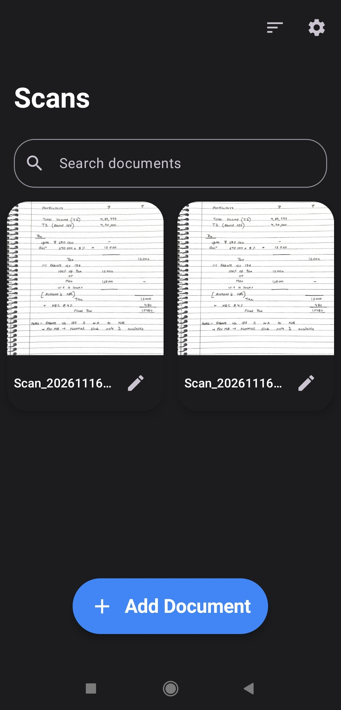 | 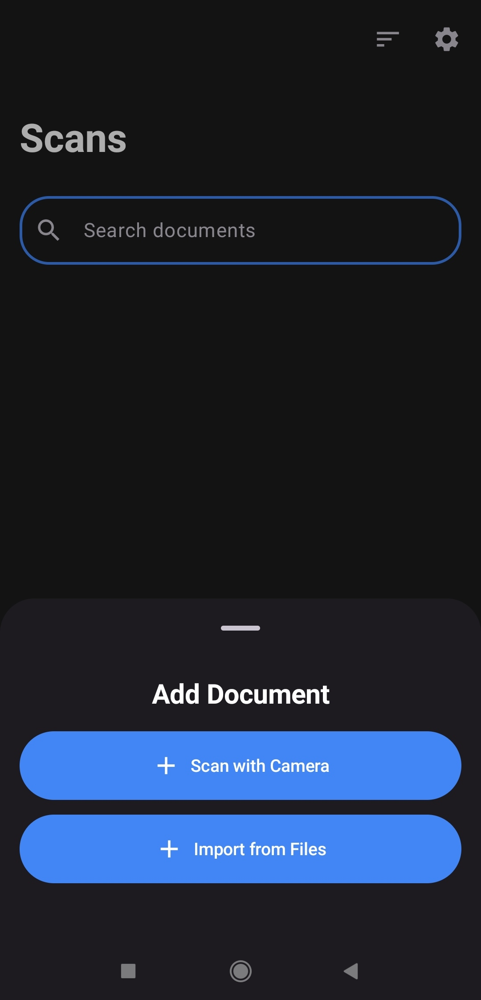 | 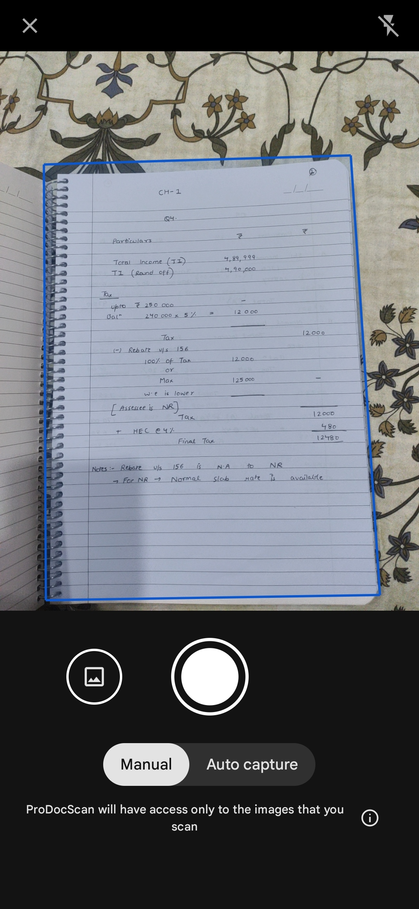 |

| OCR Text Extraction | Native Text Copying | Document Detail Preview |
| :---: | :---: | :---: |
| 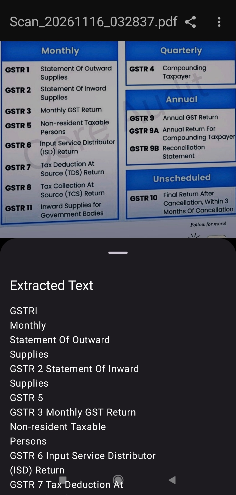 | 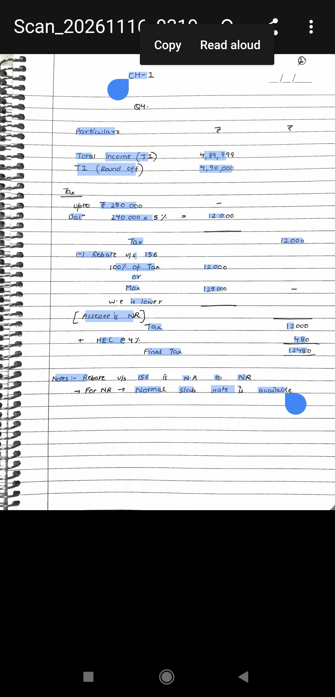 | 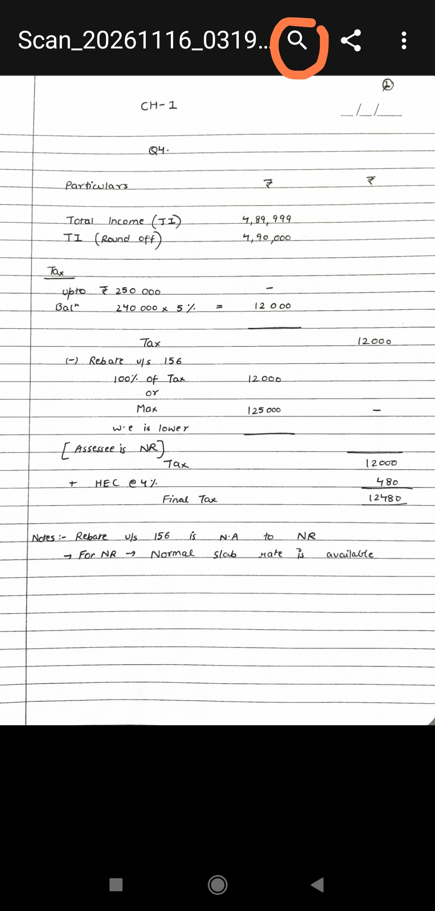 |

| Document Actions Menu | Settings & Preferences | AI Stain & Mark Eraser |
| :---: | :---: | :---: |
| 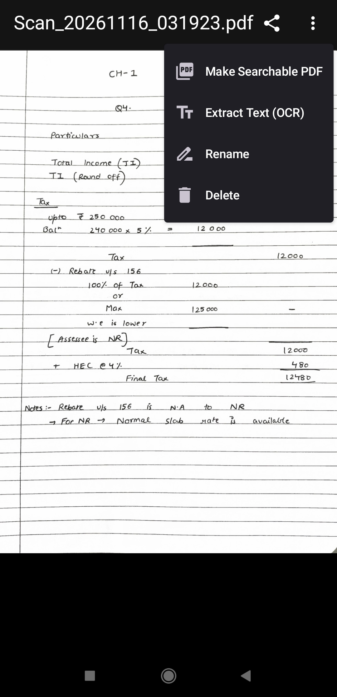 | 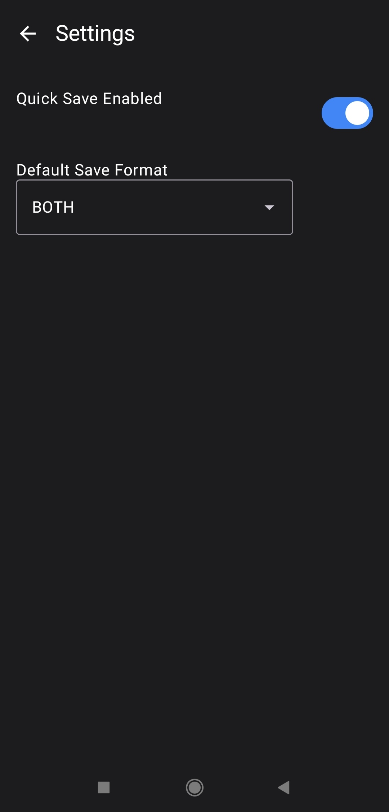 | 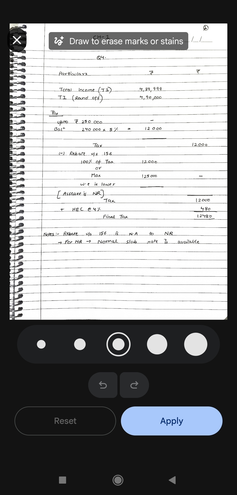 |

| Color Filters & Enhancement | Crop & Rotate Adjustment | Scanner Post-Capture Review |
| :---: | :---: | :---: |
| 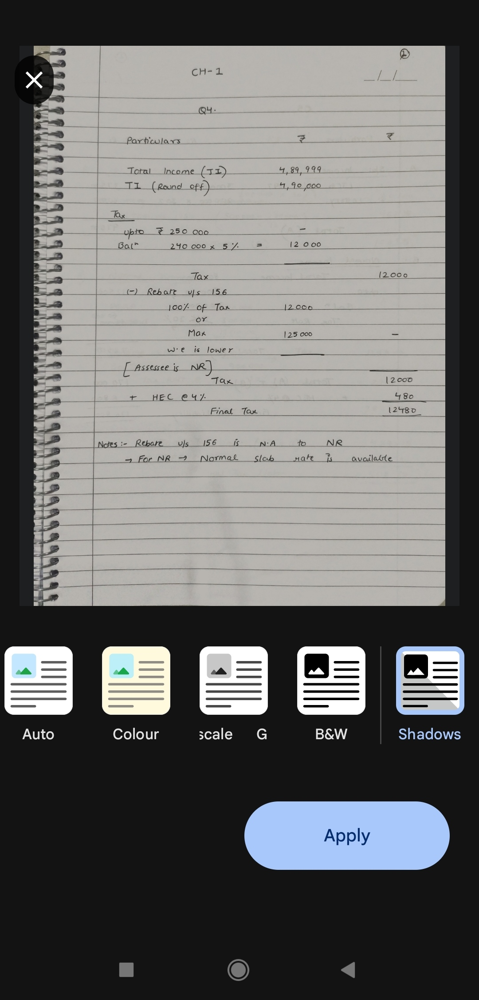 | 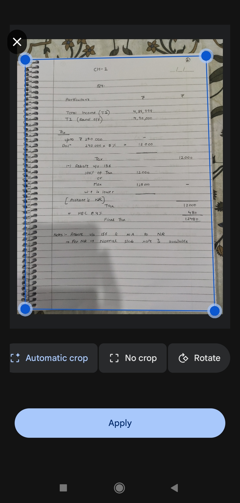 | 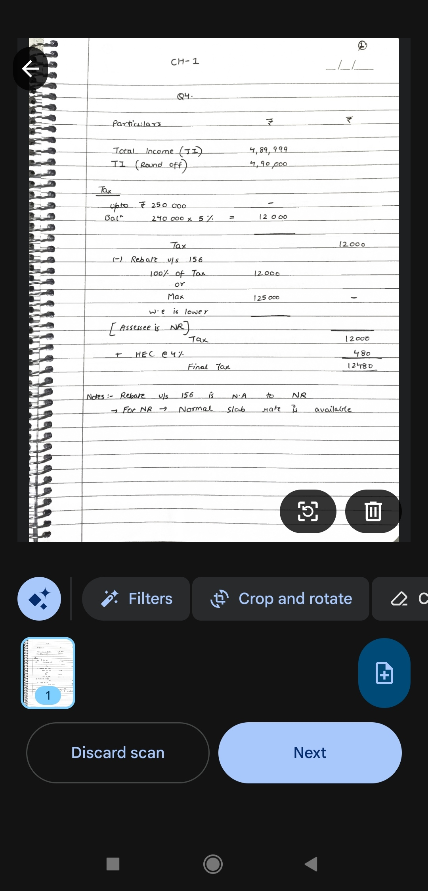 |

---

## ✨ Key Features

- **🤖 AI-Powered Scanning:** Google ML Kit backend with automatic boundary detection, perspective cropping, and ML-enabled stain/finger erasing (`SCANNER_MODE_FULL`).
- **🔒 100% On-Device & Private:** All document processing, OCR, and PDF generation happen locally on your phone. No cloud servers, no account registration, and zero data leaves your device.
- **🎨 Apple HCI Minimalist Aesthetic:** Features iOS-style Large Titles, 24dp rounded squircle cards, translucent frosted glass overlays, and an Azure Blue on Charcoal Grey color palette.
- **🇮🇳 Multi-Language Devanagari OCR:** On-device text recognition supporting English, Hindi, Marathi, Sanskrit, Nepali, and other Devanagari scripts.
- **🔍 Searchable PDFs with Visual Highlighting:** Convert scanned images or existing PDFs into true Searchable PDFs. Search for words in-app and watch the camera automatically pan and draw yellow highlight boxes over the text.
- **📋 Native Text Selection & Copy:** Long-press anywhere on a Searchable PDF to trigger Android's native text selection cursors—highlight and copy text straight off flat document images for bulk copy-pasting.
- **📁 Complete Document Management:**
  - **Import Existing PDFs:** Native file picker to import PDFs directly from storage.
  - **Merge Images to PDF:** Bulk-select image scans and stitch them into a single multi-page PDF.
  - **True PDF Thumbnails:** Automatically generates and caches first-page PDF previews in the gallery.
  - **Quick-Save Settings:** Dedicated Settings screen with customizable default formats (PDF, Image, or Both).
  - **Direct Renaming:** Edit document names straight from the gallery cards.
- **⚡ Performance & Memory Hardened:** Built with strict bitmap recycling (`bitmap.recycle()`) to prevent crashes during large bulk operations.

---

## 📱 Installation & Usage

1. Download the latest `ProDocScan-release.apk` file from the repository.
2. Open the file on your Android device (ensure "Allow installation from unknown sources" is enabled in settings if prompted).
3. Tap **Scan Document** or **Import File** to begin scanning and processing!

---

## 📖 Development Story

Interested in how this application was built from scratch? Check out our complete, step-by-step development log in [`DEVELOPMENT_JOURNEY.md`](DEVELOPMENT_JOURNEY.md).

---

## 🤖 Non-Technical Vibe Coding Guide

ProDocScan is optimized for **AI-Assisted Vibe Coding**. If you are a non-technical contributor (CA, CS, CMA, or business user) using Claude, Gemini, or ChatGPT, follow these steps to build new features or fix bugs:

1. **Using Claude (Recommended #1):**
   - Drag the whole `ProDocScan` folder into **Claude Desktop** or **Claude Code**.
   - Claude will automatically read `CLAUDE.md` and understand the entire architecture!
   - Describe what you want in plain English: *"Add a toggle to sort documents by file size."*

2. **Using Google Gemini (#2):**
   - Open **Gemini** or **Gemini Code Assist** in Android Studio.
   - Point Gemini to `GEMINI.md`.
   - Paste your feature idea.

3. **Using ChatGPT / Cursor (#3):**
   - Attach `AGENTS.md` or `.cursorrules` to your prompt.
   - Ask ChatGPT to implement the changes and give you the updated code!

---

## 📄 License

This project is licensed under the Apache License, Version 2.0 - see the [LICENSE](LICENSE) file for details.

---

*Maintained with ❤️ by ProWoFlow Automation Tools.*
